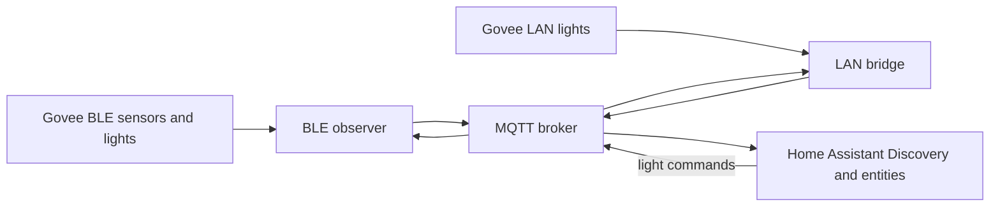

# mqtt_ble — BLE ↔ MQTT for Home Assistant

A small macOS bridge for bringing Govee BLE sensors and lights into Home Assistant through
MQTT, with a separate local-network bridge for Govee LAN lights. The services run locally
and use MQTT Discovery to create Home Assistant entities.

## Data flow



## Features

- **BLE sensors:** publish temperature, humidity, and battery readings.
- **BLE lights:** expose power, brightness, RSSI, and online state where supported.
- **Govee LAN lights:** discover and control compatible lights on the local network.
- **Home Assistant Discovery:** create entities through standard MQTT Discovery topics.
- **Device learning:** an opt-in, time-limited window can add new BLE devices to the local allowlist.
- **MQTT monitor:** inspect `govee/#` traffic while troubleshooting.

## Requirements

- macOS with Bluetooth access and permission for the Python process
- Python 3.10 or newer
- An MQTT broker reachable from the Mac
- Govee LAN Control enabled for lights using the LAN bridge

## Setup

```bash
python3 -m venv .venv
source .venv/bin/activate
pip install -r requirements.txt -c constraints.txt
cp mqtt.env.example mqtt.env
chmod 600 mqtt.env
```

Fill in `mqtt.env` with the broker host, port, username, and password. This local file is
ignored by Git. Configuration can also be supplied through `MQTT_HOST`, `MQTT_PORT`,
`MQTT_USER`, and `MQTT_PASSWORD` environment variables. Missing or placeholder credentials
cause the services to stop with a clear error.

## Run

Start the BLE observer and the LAN bridge in separate terminals:

```bash
.venv/bin/python observe_bleak.py
.venv/bin/python goove_mqtt_bridge.py
```

For broker diagnostics, run:

```bash
.venv/bin/python monitor_mqtt.py
```

See [Home Assistant setup](HOME_ASSISTANT_SETUP.md) for the MQTT integration, entities,
topics, and troubleshooting guidance.

## Topics

| Purpose | Topic pattern |
|---|---|
| BLE sensor state | `govee/<MAC>` |
| BLE light commands | `govee_ble/light/<MAC>/set` |
| BLE light state | `govee_ble/light/<MAC>/state` |
| Govee LAN commands | `govee/<MAC>/set` |
| Govee LAN state | `govee/<MAC>/state` |
| Home Assistant discovery | `homeassistant/<component>/<device>/config` |

The observer also publishes its online state and the learning switch through dedicated
`mqtt_ble/observe/` topics.

## Tests

```bash
python -m unittest discover -s tests -v
```

## Project layout

```text
observe_bleak.py       BLE scan, sensor/light discovery, and learning mode
goove_mqtt_bridge.py  local Govee LAN discovery and control
mqtt_config.py        environment and mqtt.env configuration
learn_mode.py         time-limited device learning and allowlist logic
tests/                configuration, learning, BLE cache, and runtime tests
```
